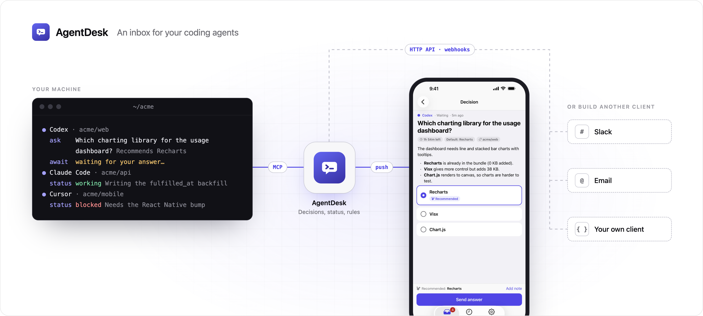

<picture>
  <source media="(prefers-color-scheme: dark)" srcset=".github/readme/header-dark.png">
  
</picture>

# AgentDesk

AgentDesk is an inbox for your coding agents. Agents can now work for a whole day, and what stops them is you. When an agent reaches a call it shouldn't make alone, it asks in the terminal and waits until you're back at your desk. With AgentDesk, it asks over MCP instead. You answer from the mobile app or another client, wherever you are, and the agent keeps going.

- Agents ask approve-or-reject, multiple-choice, or free-text questions, with a recommendation and an optional deadline and default.
- Live status cards show what each agent is doing and flag agents that have gone quiet.
- Server-side notification rules decide what notifies you right away, what waits for the daily digest, and what stays silent.
- One install per machine covers every repository. It works on remote devboxes over SSH, and you approve the machine from your phone.
- A published HTTP API and webhooks let anyone build another client, such as Slack or email.

AgentDesk is in early development. The Android app is on [Google Play](https://play.google.com/store/apps/details?id=sh.kidus.agentdesk). The iOS app is not in the App Store yet. To run it on a simulator, follow [apps/mobile/README.md](apps/mobile/README.md).

## Install

On macOS or Linux:

```sh
curl -fsSL https://agentdesk.kidus.sh/install | sh
```

The script downloads and verifies the `agentdesk` binary, then sets up whichever of Claude Code, Codex, and Cursor it finds, for every repository on the machine. To sign in, it shows a short code that you approve in the AgentDesk app, so it works over SSH too. When it finishes, start a new agent session.

To set up only some of them, pass `--only`:

```sh
curl -fsSL https://agentdesk.kidus.sh/install | sh -s -- --only codex
```

`agentdesk status` checks each connection. `agentdesk uninstall` removes everything the installer wrote.

In Cursor, a reply you type while the agent waits on a question gets queued. Press Enter on it to send it to the agent.

## License

MIT. See [LICENSE](LICENSE).
